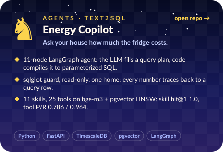
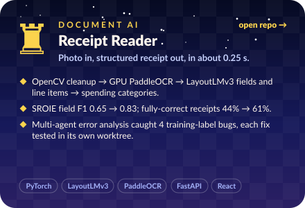
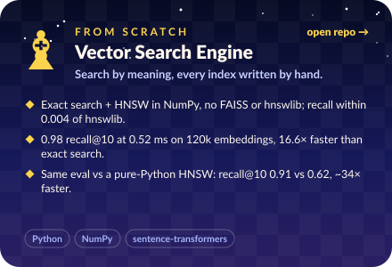
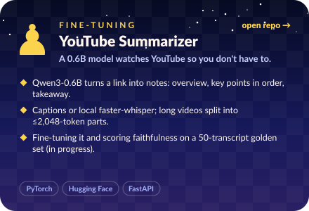

<table style="border: none;">
<tr>
<td align="center">

<b>AI Engineer @ Research Institute of Posts and Telecommunications</b>

<i>B.S. Information Technology @ PTIT, Hanoi · GPA 3.7/4.0</i>

<i>Undergraduate Researcher (AI Agents · UI2Code) with University of Luxembourg</i>

</td>
</tr>
</table>

## About me

I grew up as a chess player. For years my evenings were spent over a board, calculating lines, studying openings and learning to lose gracefully. Chess taught me to think several moves ahead, to stay patient in complicated positions and to treat every mistake as something to study rather than something to hide.

Programming found me through the same curiosity. The first time I wrote code that actually worked, it felt like solving a puzzle where I also got to design the board. I came to love building things: small scripts at first, then web apps, then systems that could reason on their own. I stopped playing seriously, but the habit of calculating before moving never left.

Today I'm an **AI Engineer at the Research Institute of Posts and Telecommunications**, where I build multi-agent LLM systems and retrieval platforms that run more than 110 chatbots in production. I'm also an undergraduate researcher with the **University of Luxembourg**, studying how AI agents turn UI designs into working code, while finishing my B.S. in Information Technology at **PTIT** in Hanoi. In a way I'm still playing chess, only now the pieces are agents and the goal is to make them think well together.

Happy to talk about LangGraph, RAG, Text2SQL, document AI and agent evaluation.

## What I work on

## Featured projects

## Tech Stack

## Match stats ♟

 

Vietnamese (native) · English (IELTS 6.0) — open to AI Engineer (LLM) roles and research collaborations. Your move ♟

